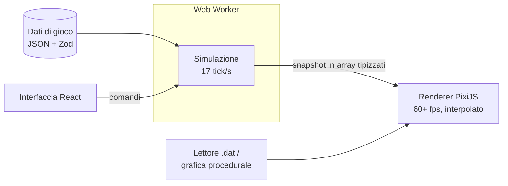

  

<a href="README.md">🇬🇧 English</a> · <b>🇮🇹 Italiano</b>

  
  

> [!NOTE]
> Questo repository è una **vetrina del progetto**: il codice sorgente è privato. Una demo è disponibile su richiesta.

## 🧭 Panoramica

**MyTheSettler** è un motore di gioco strategico in tempo reale, basato sull'economia, che gira nel browser. Riproduce la logica di gioco esatta di un classico per PC di fine anni '90, con una grafica 2.5D moderna.

Il progetto unisce il **reverse engineering** (formati binari originali degli asset, regole e numeri di gioco ricostruiti da documentazione e misurazioni della community) a un'architettura moderna e completamente testata.

## ✨ Funzionalità principali

- 🔍 **Reverse engineering dei formati originali**: un lettore scritto da zero per gli archivi grafici `.dat`, per caricare gli sprite da una copia del gioco posseduta dall'utente
- 📚 **Logica di gioco ricostruita dalle fonti**: ogni regola e ogni numero ha la sua fonte e il suo grado di affidabilità, i valori ignoti sono marcati esplicitamente come stime
- 🧵 **Simulazione in un Web Worker** a 17 tick al secondo fissi, mentre il rendering resta a 60+ fps interpolando tra gli snapshot
- 🗺️ **Mappa esagonale** con generatore di terreno e pathfinding **A\*** per migliaia di coloni
- 🏗️ **Economia completa**: portatori e logistica, cantieri, legno, cibo, miniere e fabbri, con impostazioni economiche, statistiche e avvisi
- 🧩 **Progettazione guidata dai dati**: edifici e comportamenti dei lavoratori definiti in JSON e validati con Zod
- 🎨 **Grafica procedurale** disegnata via codice, per sostituire del tutto gli asset originali
- ✅ **Circa 300 test automatici** che girano in Node, senza browser

## 🏗️ Architettura

## 🧰 Tecnologie

## 📬 Contatti

Realizzato da **Salvatore Cutaia**, ingegnere informatico specializzato in agenti AI e automazioni.

