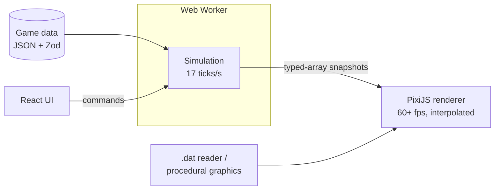

  

  
  

> [!NOTE]
> This repository is a **project showcase**: the source code is private. A demo is available on request.

## 🧭 Overview

**MyTheSettler** is a real-time economy strategy game engine for the browser, built to reproduce the exact game logic of a late-90s PC classic with modern 2.5D graphics.

The project combines **reverse engineering** (original binary asset formats, game rules and numbers reconstructed from documentation and community measurements) with a modern, fully tested architecture.

## ✨ Key features

- 🔍 **Reverse engineering of the original formats**: a custom reader for the legacy `.dat` graphics archives, to load sprites from a user-owned copy of the game
- 📚 **Game logic reconstructed from sources**: every rule and number is tracked with its source and reliability, unknown values are explicitly marked as estimates
- 🧵 **Simulation in a Web Worker** at a fixed 17 ticks per second, while rendering stays at 60+ fps with interpolation between snapshots
- 🗺️ **Hex-grid map** with terrain generator and **A\*** pathfinding for thousands of settlers
- 🏗️ **Full economy**: carriers and logistics, construction sites, wood, food, mines and smiths, with economic settings, statistics and alerts
- 🧩 **Data-driven design**: buildings and worker behaviours defined in JSON and validated with Zod
- 🎨 **Procedural graphics** drawn in code, to replace the original assets entirely
- ✅ **~300 automated tests** running in Node, no browser needed

## 🏗️ Architecture

## 🧰 Tech stack

## 📬 Contact

Built by **Salvatore Cutaia**, Computer Engineer specialized in AI agents & automations.

